<p align="center">
  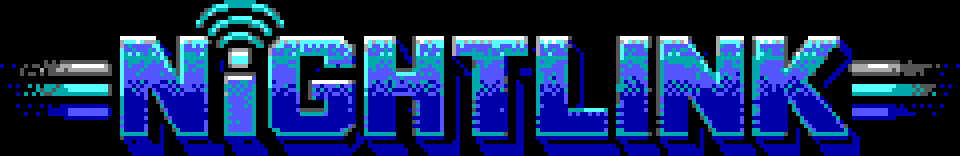
</p>

<p align="center">
  <b>A Windows desktop companion for MeshCore radios.</b><br>
  Chat on mesh channels, send direct messages and watch the network over Bluetooth LE or USB, with a BBS-style terminal interface or a modern card layout.
</p>

<p align="center">
  <a href="https://github.com/njsnowman/nightlink/releases/latest"></a>
  <a href="https://github.com/njsnowman/nightlink/releases"></a>
  
  
</p>

<p align="center">
  <a href="https://github.com/njsnowman/nightlink/releases/latest"><b>Download</b></a> ·
  <a href="#quick-start">Quick start</a> ·
  <a href="#screenshots">Screenshots</a> ·
  <a href="#features">Features</a> ·
  <a href="docs/nightlink-full-help.md">Full guide</a> ·
  <a href="https://github.com/njsnowman/nightlink/issues/new?labels=bug">Report a bug</a>
</p>

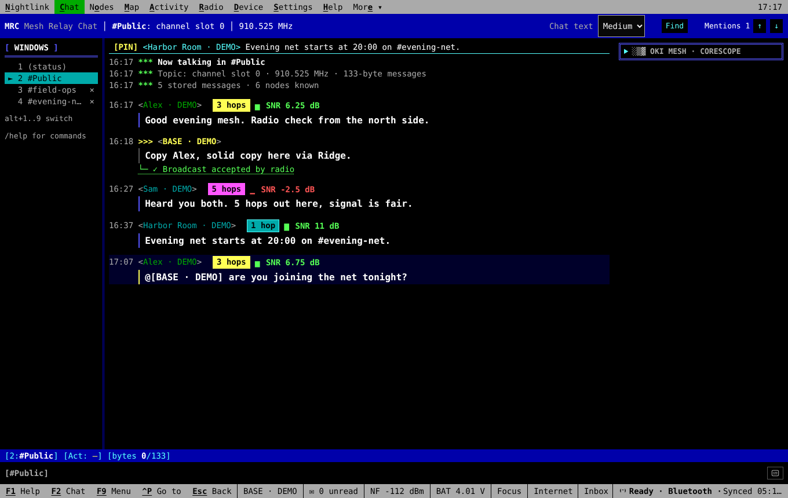

> **Development note:** Nightlink is developed with AI assistance. If you prefer not to use software built that way, don't use it.

## How it connects

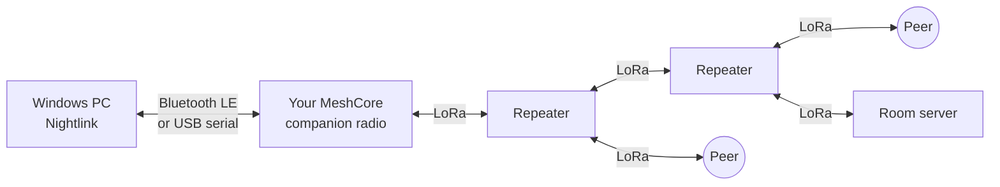

Nightlink talks only to **your own** companion radio. Everything on the mesh goes through that radio. Messages, contact cards and settings are stored on your computer.

## Quick start

1. **Download** `Nightlink-Setup-<version>.exe` (installer) or `Nightlink-Portable-<version>.exe` (no install) from the [latest release](https://github.com/njsnowman/nightlink/releases/latest).
2. **Verify** the file against `SHA256SUMS.txt` from the same release:
   ```powershell
   Get-FileHash .\Nightlink-Setup-<version>.exe -Algorithm SHA256
   ```
   Don't run it if the hash differs. The executables are unsigned, so Windows SmartScreen may warn you: choose **More info → Run anyway** after checking the hash.
3. **Start Nightlink.** On a new install, the **setup guide** walks you through connecting your radio and links to the matching help topics. You can reopen it any time from **Ctrl+P → Setup guide**.
4. **Connect.** Choose **Connect radio**, pick **Bluetooth** or **USB**, and select your radio. Channels, contacts and retained messages synchronize automatically.

<p align="center">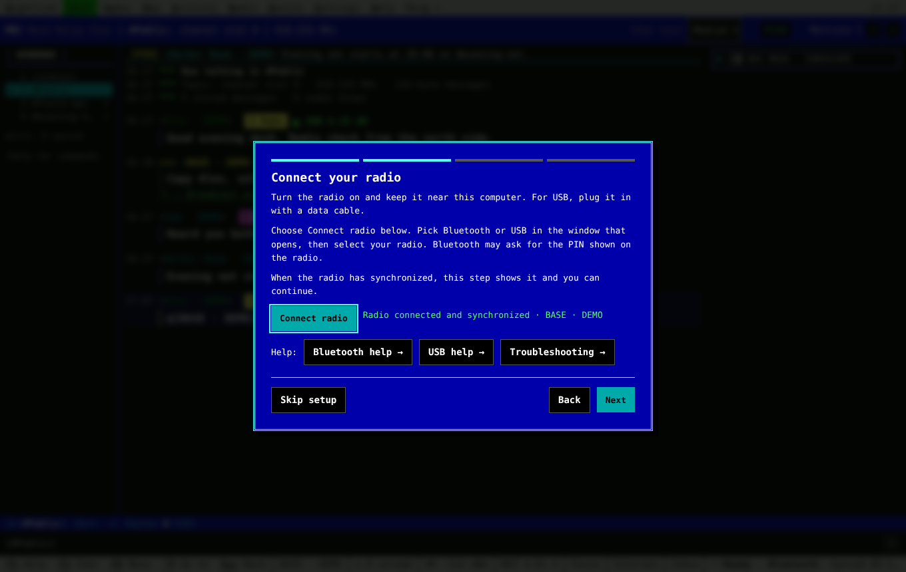</p>

**Upgrading:** export a backup first (**Settings → Data & updates → Backup and restore**), quit Nightlink from the tray icon, then run the new Setup over the old one.

## Screenshots

All screenshots use the real interface with fictional "DEMO" data. No radio or personal information is shown. They're regenerated with `node scripts/readme-screenshots.cjs`.

### Terminal interface (default)

| | |
|---|---|
| 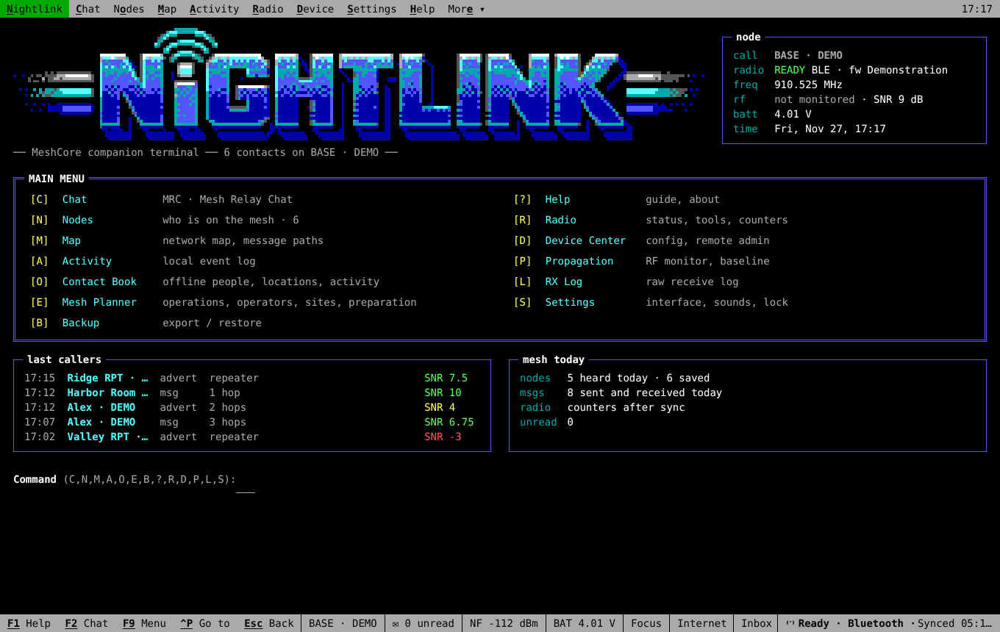 **Overview:** ANSI logo, node summary, main menu, last callers and today's mesh. |  **Mesh Relay Chat:** hop and SNR badges, a pinned message, mentions and the status line. |
| 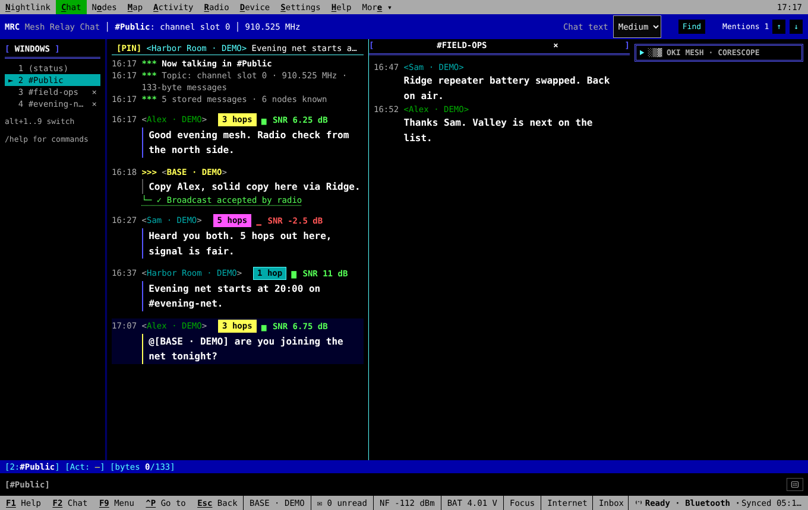 **F6 split view:** follow a second channel beside the active one. | 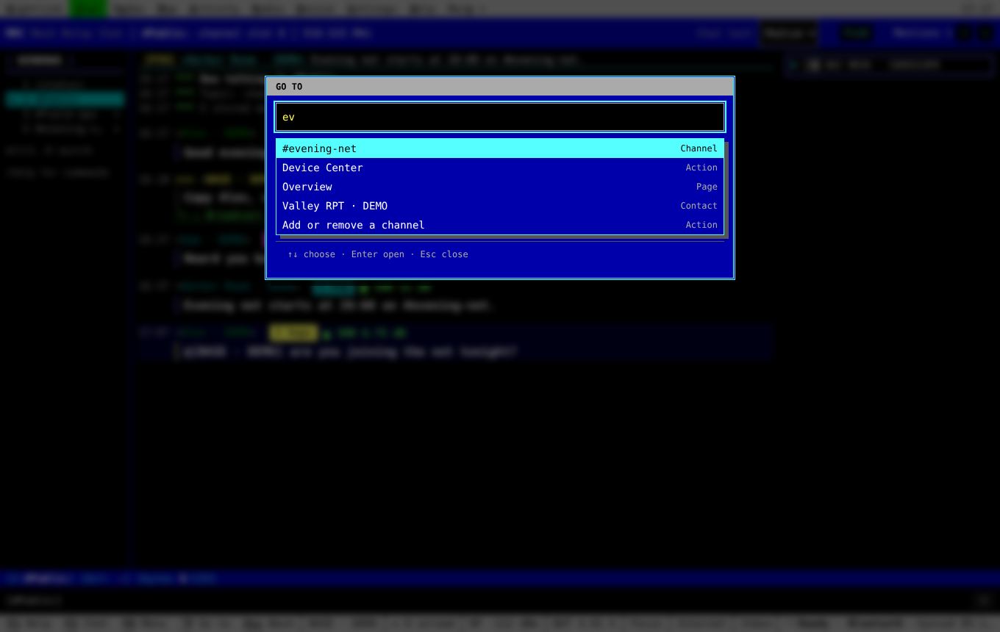 **Ctrl+P Go to:** jump to any page, channel, contact or action. |
| 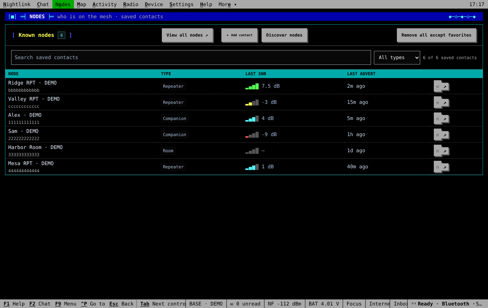 **Nodes:** LAST SNR with signal bars and advert age for every saved contact. | 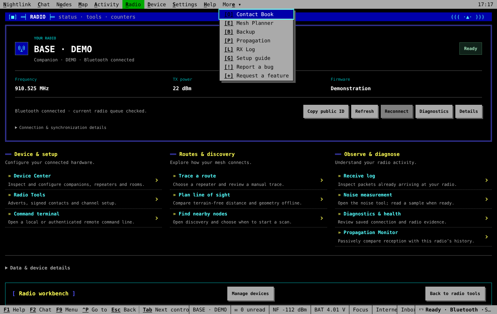 **More menu:** Contact Book, Mesh Planner, Backup, Propagation, RX Log and more. |

### Cards interface (alternate)

| | |
|---|---|
| 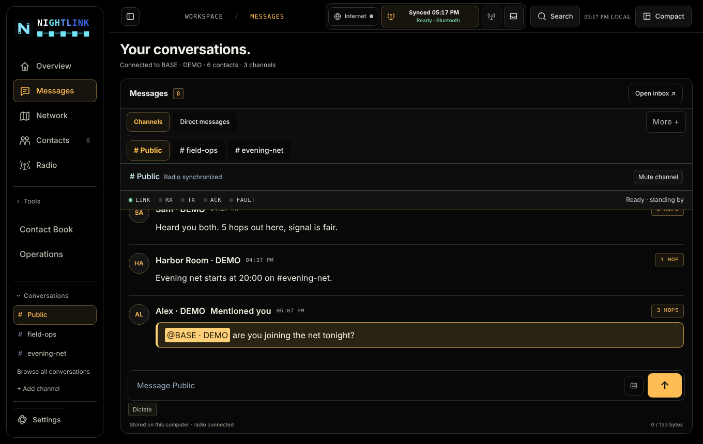 **Messages:** channel tabs, mention highlights, hop badges and the Signal Rail. | 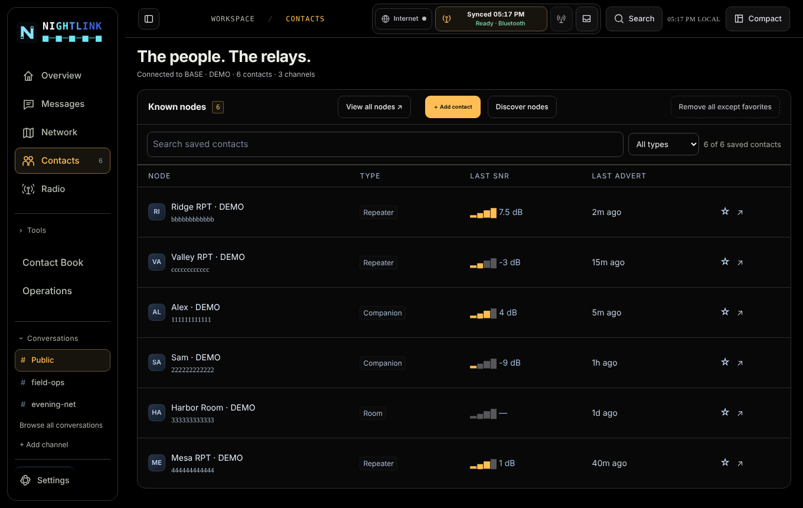 **Contacts:** the same LAST SNR bars and advert ages. |
| 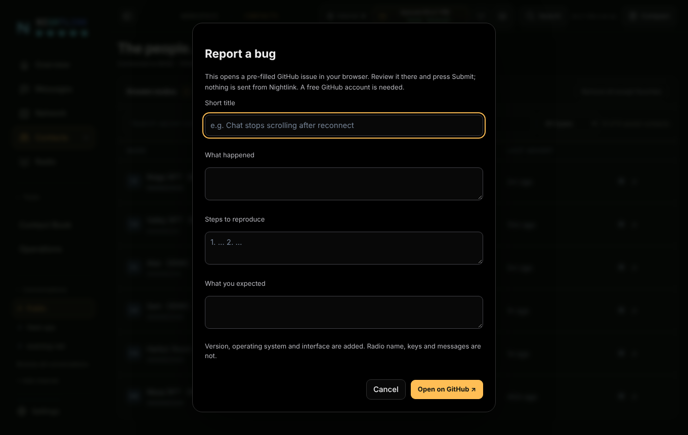 **Report a bug / Request a feature:** opens a pre-filled GitHub issue. | |

Switch between them in **Settings → Interface**.

## Features

### Messaging
- Channel and direct messages with local history: up to 3,000 messages per radio.
- Direct-message ACK tracking, bounded retries, flood fallback, cancellation and delivery details.
- Replies, reactions, `@[name]` mention autocomplete and highlighting, link and image previews.
- **Pinned messages** (`/pin`, `/pins`, `/unpin`), **Find**, drafts that survive switching windows, and a remembered reading position.
- Detached direct-message windows and configurable notification sounds, including **Modem** and **BBS bells** packs.
- Add or remove channels from the radio (`/join`, `/part`, or the channel dialog).

### Network and radio
- **Nodes:** LAST SNR from direct adverts and the final hop of messages, shown with signal bars, plus advert age.
- Message paths: numbered repeaters, signal per hop and an animated path map.
- Radio workbench: Trace Path, offline Line of Sight, RX Log, Noise Floor, Discover Nodes and CLI.
- **Device Center:** companion configuration, authenticated repeater and room administration, and USB text-CLI setup, all with reviewed changes and readback.
- **Propagation Monitor:** passively compares current reception with your radio's own history.
- CoreScope, MeshMapper and a local Radio map, each of which can be turned off separately.
- Contact Book, Mesh Planner (operations, sites, RF studies) and offline map preparation.

### Terminal interface
- VGA 16-colour palette, monospace type, bordered frames, bracketed hotkeys and visible keyboard focus.
- **Status line:** node, unread count, DMs, noise floor, battery, internet, inbox, update notice and the radio connection.
- **F6 split view**, **nick colours by sender**, **custom colours** (refused below 4.5:1 contrast), and Daylight and High-contrast palettes.
- Modem dial-up startup screen with ANSI art, and a NO CARRIER sign-off screen.

### Everywhere
- **Ctrl+P** command palette and **F1** offline help with 22 topics and screenshots.
- **Setup guide** for new users, and **Report a bug / Request a feature** forms.
- Local backup and restore, an optional startup lock with recovery codes, and Focus mode (Ctrl+B).

## Keyboard shortcuts

| Key | Action |
|---|---|
| `Ctrl+P` | Go to: pages, channels, contacts, actions |
| `Ctrl+K` | Search messages |
| `F1` | Help |
| `F2` | Chat |
| `F6` | Split view: next window, then off (Terminal chat) |
| `F9` | Main menu (Terminal) |
| `Alt+1`…`Alt+9` | Switch chat window (Terminal) |
| `Ctrl+B` | Focus mode: hide the menus |
| `Esc` | Back, or close a dialog |
| `/help` | All chat commands (Terminal) |

## Connections

**Bluetooth:** use MeshCore BLE companion firmware and turn on Windows Bluetooth. Only one client can be connected to the radio at a time. Nightlink synchronizes channels, retrieves retained messages and refreshes contacts and telemetry.

**USB:** use a data-capable cable. In **Connect radio**, choose **USB cable → Choose USB port** and select the radio's COM port (115200 baud, MeshCore companion framing). USB and Bluetooth share the same local history, keyed by the radio's public identity.

If the link drops, Nightlink reconnects with backoff, and the status line shows the countdown.

## What delivery means

- A radio **accepting** a channel message doesn't confirm that anyone received it.
- Direct messages track the **recipient radio's ACK**. A missing ACK stays "unconfirmed".
- After reconnecting, Nightlink retrieves the messages your powered radio kept. That queue is finite: it can overflow, it may be cleared by a reboot, and another connected client can consume it.

## Privacy and storage

- Message history, contact cards and settings stay **on this computer**. History is not encrypted at rest. The optional startup lock protects opening the app; it doesn't encrypt your data.
- Channel secrets and Bluetooth PINs are not stored in history.
- CoreScope and MeshMapper need internet access and depend on those external services; you can turn either off.
- Update checks read the public GitHub release feed. They need no account and send no personal data.
- Bug reports open a GitHub issue in your browser. Nothing is sent until you press Submit there, and your radio name, keys and messages are not included.

## Feedback

- [Report a bug](https://github.com/njsnowman/nightlink/issues/new?labels=bug) or [request a feature](https://github.com/njsnowman/nightlink/issues/new?labels=enhancement), or use **More → Report a bug** inside the app, which fills in your version and platform.
- Include your radio model and firmware, the connection type (Bluetooth or USB), and the exact steps. Don't attach message backups or authenticator secrets.

## Development

```bash
npm install
```

```bash
npm start
```

```bash
npm test
```

```bash
npm run test:browser
```

```bash
npm run dist
```

- `npm start` runs the Electron app. `npm run preview` serves the local browser preview.
- `npm test` runs the protocol, transport, delivery and UI logic tests (Node's test runner).
- `npm run test:browser` runs about 100 Playwright suites, including a 146-screen accessibility audit. Set `NIGHTLINK_BROWSER` to a Chromium path if needed.
- `npm run dist` builds `Nightlink-Setup-<version>.exe` and `Nightlink-Portable-<version>.exe`.

Interface work follows [DESIGN_SYSTEM.md](DESIGN_SYSTEM.md): Terminal is the default standard, and Cards is the alternate.

Every release has a tracking issue, a changelog entry, a validation record (with physical-radio evidence kept separate from simulated tests), the source commit and the artifact checksums. See [RELEASE_PROCESS.md](RELEASE_PROCESS.md), [CHANGELOG.md](CHANGELOG.md), [releases/](releases/) and the [download history](releases/DOWNLOADS.md).

## References

- [MeshCore firmware and companion protocol](https://github.com/meshcore-dev/MeshCore)
- [MeshCore documentation](https://docs.meshcore.io/)
- [Electron device access](https://www.electronjs.org/docs/latest/tutorial/devices)
- Leaflet is distributed under its [BSD license](vendor/LEAFLET-LICENSE). Third-party notices are listed in **Help → About**.
