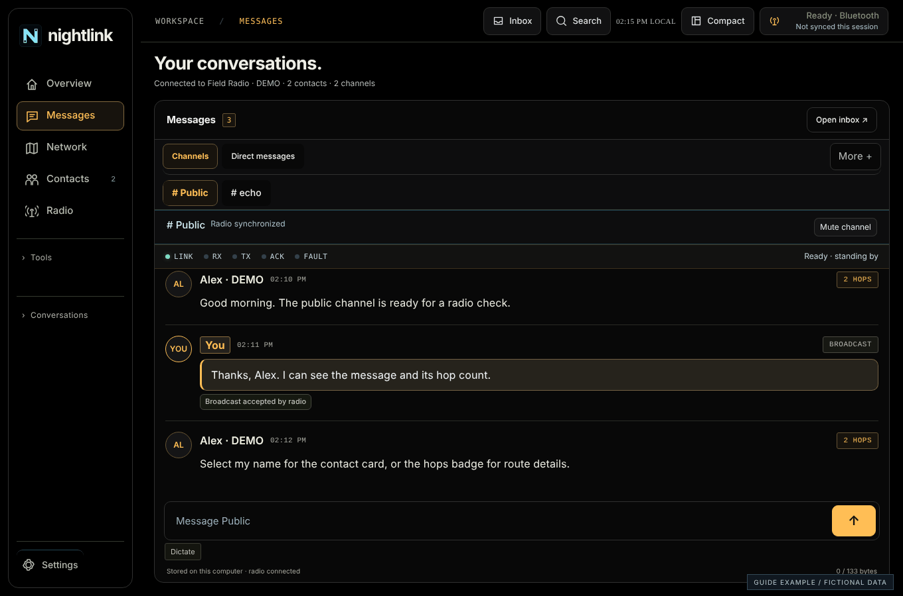
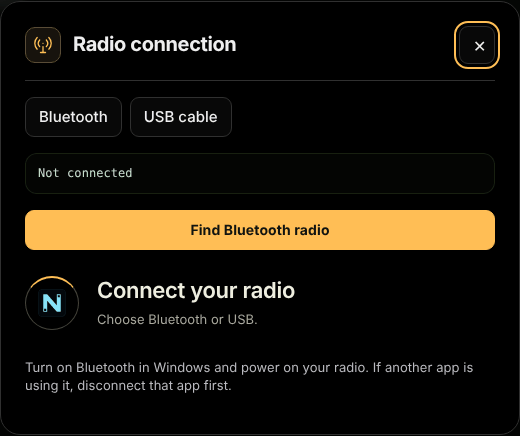
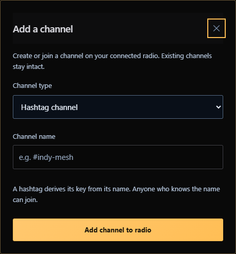
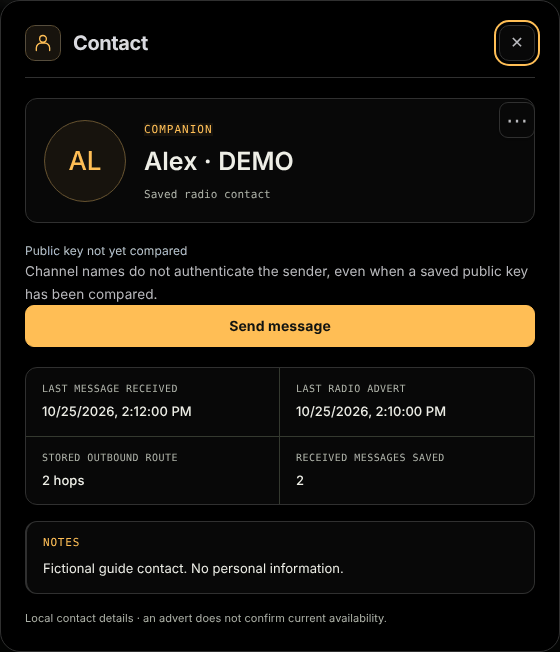
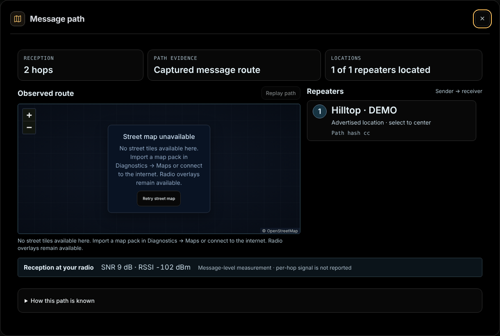
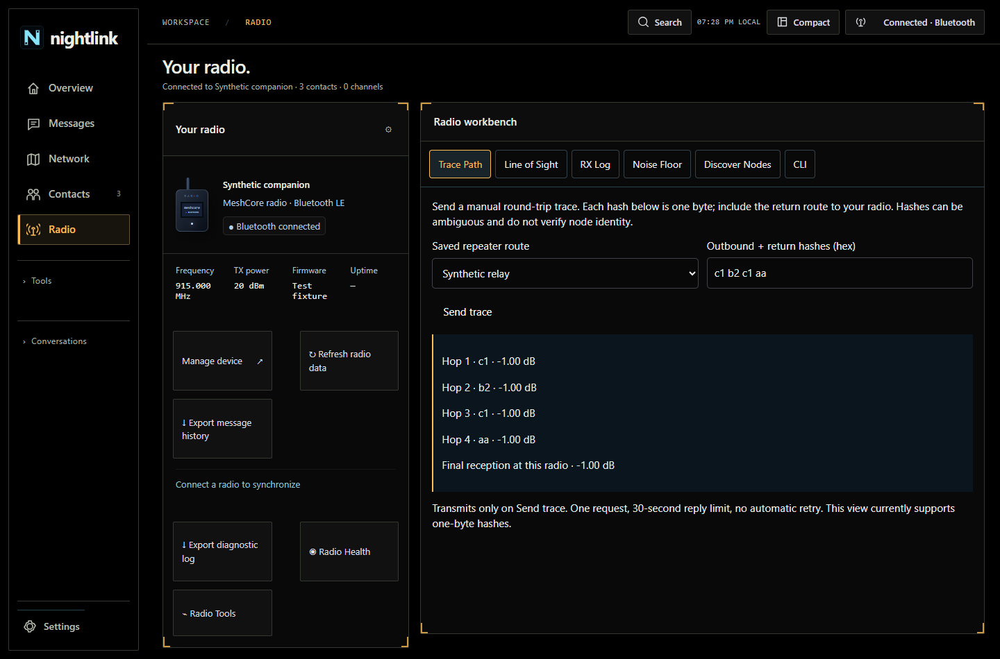
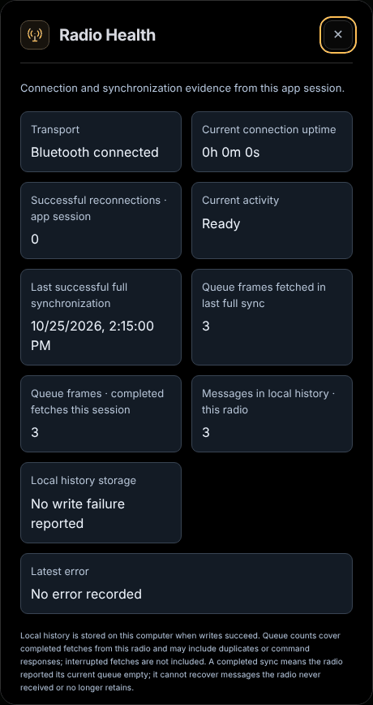
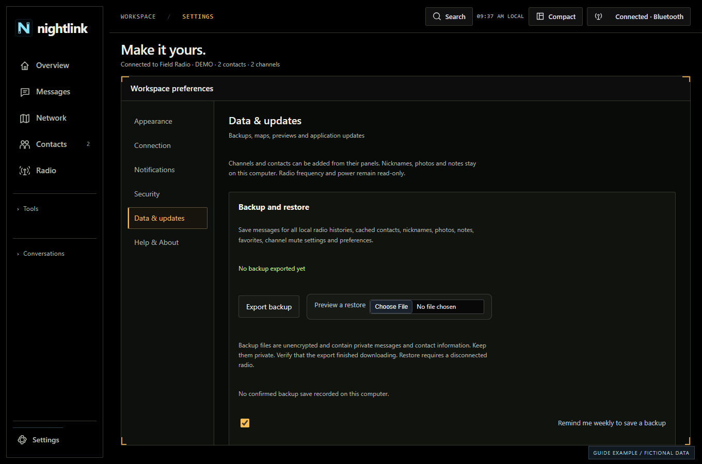
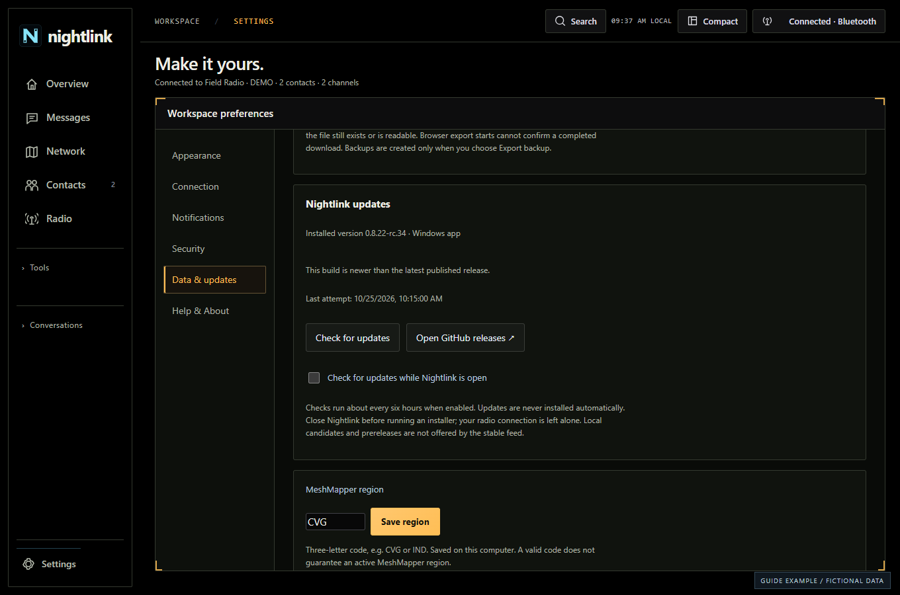

# Nightlink user guide

Updated 2026-10-31. Open **Settings > Help & About** or **Tools > Help & About**. Version 0.8.26 adds Device Center, radio contact removal, Signal Rail and the activity inbox, live delivery details, map visibility settings and the Overview messages/map divider. See the [documentation index](DOCUMENTATION.md).

Actual Nightlink interface with fictional demonstration data. No physical-radio session is shown.

## Radio workbench and message paths

Six radio tools, public identity and path evidence.

### Trace Path

Open Radio, select a repeater by name and review the forwarding sequence before sending. Advanced accepts one-byte hashes. Omit your own companion from forwarding hops. Queue acceptance is separate from a returned trace. The reply deadline is bounded to 30–120 seconds; there is no automatic retry.

### Other tools

- Line of Sight calculates offline geometry from coordinates, antenna heights and frequency. It does not check terrain, buildings or actual coverage.
- RX Log shows passive firmware observations. RSSI/SNR describe the final received link, not every repeater.
- Noise Floor explicitly reads the companion statistic on protocol 8+; it does not send a mesh test packet.
- Discover Nodes requires Search nearby to transmit a zero-hop request. The scan lasts seven seconds with a sixty-second cooldown; results are not automatically saved or trusted.
- CLI targets the companion or an authorized remote node. General local commands require protocol 14+; older firmware supports limited reads. Remote administration requires compatible firmware and login.

### Copy public ID

Open Radio and select Copy public ID, or use shared-contact export. Copy the full 64-character public key; selectable text is available if clipboard access fails. Compare full keys through a trusted channel. Never share private keys, channel secrets or authenticator setup material.

### Message paths

Select the hops badge to open numbered repeater cards and the map. Consecutive located hops animate in order; Replay path repeats the presentation. Reduced motion suppresses animation. Unknown locations remain gaps. This illustrates stored route evidence, not live packet tracking.

### Mention alerts

Exact mentions of your current radio name receive a Mentioned you badge. Simple @name and bracketed @[multi word name] forms are supported. Settings > Notifications includes mention sound and Test mention sound. Muted conversations, quiet hours, your own messages, duplicates and recovered history do not trigger a new alert.

### Validation scope

A returned direct trace through one repeater was physically confirmed on the recorded Heltec USB setup. Earlier timeouts remain unexplained and multihop reliability is unverified. Consult the release notes for installer and optional-lock validation limitations.

## Start here

Connect a radio, choose a channel and send your first message.

### Your first session

1. Install Nightlink using the Windows Setup download. The portable build runs without installing; keep using the same Windows profile to retain local data.
2. Power on a MeshCore companion radio. For Bluetooth, disconnect phone apps or other clients using that radio. For USB, use a data-capable cable and USB companion firmware.
3. Select Connect radio in the top-right corner. Choose Bluetooth or USB, then choose your radio.
4. Allow synchronization to finish. The connection window closes automatically and opens Overview.
5. Open Messages. Channels comes first, followed by Direct messages. Choose a channel, type a short message and select Send.

### Know the five main destinations

- Overview: recent channel messages, connection summary and live mesh map.
- Messages: channels, direct conversations and message search.
- Network: CoreScope, your Radio map and the configured MeshMapper region.
- Contacts: saved radio contacts, personal contact cards and nearby discovery.
- Radio: your companion details, synchronization, Radio Health and Radio Tools.

### Before going offline

Connect once, confirm your channels and contacts, export a backup and import an offline map for your area. Internet maps, image links, page previews and update checks require internet access. The radio link itself does not require internet.

## Connect with Bluetooth

Find your companion radio and understand synchronization.

### Connect

1. Keep the radio powered on and close to the PC. Close other apps connected to it, including the phone client.
2. Select Connect radio, then Bluetooth and Find Bluetooth radio.
3. Choose the correct device. Complete any Windows pairing prompt shown by the device.
4. Wait while Nightlink reads identity, retained queued messages, channels and contacts. When ready, it enters Overview automatically.

### If connection fails

Check power, Bluetooth availability and distance. Confirm another client has not reconnected. Retry manually after an error. If the radio is connected but synchronization stopped, use Radio Health to review the current activity and latest error before refreshing.

### Important distinction

Connected describes the transport. Synchronization can still be working or fail afterward. Check the current status rather than assuming every message is loaded as soon as Bluetooth connects.

## Connect with USB

Use the correct cable, serial port and companion firmware.

### Connect

1. Use a USB data cable, not a charging-only cable. Connect the radio directly to the PC when troubleshooting.
2. Confirm the device runs MeshCore USB companion firmware. A board being visible as a serial port alone does not establish protocol compatibility.
3. Close serial terminals and other applications using its port.
4. Select Connect radio, choose USB, then select the matching device or COM port. Wait for synchronization and automatic Overview entry.

### Radio did not respond

Check the cable and firmware variant first, then Windows device/port availability. Do not flash firmware merely to test an uncertain port. A Bluetooth companion build may expose USB for other purposes without acting as a USB companion.

### Switch transports

Finish active sends and disconnect the current transport before choosing another radio or transport. A radio’s local history is associated with its public identity, not its display name.

## Reconnect & missing history

Understand what the radio can and cannot return after a gap.

### Automatic connection

1. Connect and synchronize your radio successfully once.
2. Open Settings > Connection and enable the startup connection option if you want Nightlink to try the remembered radio.
3. Keep the radio powered on and available. Windows permissions and exclusive access still apply; reconnect is not guaranteed when another client owns the radio.

### Messages after reconnecting

Nightlink drains messages that the companion still retains in its pending queue. It also loads history previously saved by Nightlink on this computer. A completed sync means the current pending queue reported empty; it does not mean the radio has a permanent archive of every message.

### If the phone already read them

Another client can consume pending messages. Messages visible in the iPhone app may now exist only in that app’s local history. Refresh cannot reconstruct messages no longer retained by the companion. Keep a backup of each app’s history; do not assume all clients share an archive.

### Check a suspected gap

1. Open Radio > Radio Health. Compare the last successful synchronization, queue frames fetched, locally saved count and latest error.
2. When connected and idle, select Refresh radio data. Avoid repeatedly refreshing during an active synchronization.
3. Confirm the selected channel and the correct radio identity. Search stored history if the conversation contains older messages.
4. Export the diagnostic log for support. Describe whether another client connected and whether the radio restarted.

## Channels & message actions

Read, reply, inspect hops and open a sender’s contact card.

### Navigate Messages

1. Select Messages in the sidebar. It opens Channels.
2. Choose your channel using the channel controls. Direct messages is the second primary destination.
3. Use More for Search messages, Browse conversations or Add channel. Less-used actions stay out of the main tab row.

### Three click targets

- Message body: prepares a reply. Channel replies can insert the sender mention. Review the composer and select Send yourself.
- Hops badge: opens available route information and the message path map. Missing repeater identities or locations cannot be reconstructed; a hop count is not a complete geographic trace.
- Sender name or avatar: opens the contact card, including Send message for a direct conversation.

### Latest messages and older history

Opening a conversation shows the latest messages. Incoming messages follow the bottom while you are reading the latest. If you move into older history, use the latest-message control to return. Large histories use bounded rows and paging rather than mounting every saved message.

### Reading position

Each conversation remembers where you stopped when you scroll into older history, in the main window and in detached DM windows. Reopening that conversation returns to the same message. Select New messages ↓ or Jump to latest ↓ to return to the newest messages. Opening a message from search or the activity inbox shows that exact message instead. Backups include saved reading positions.

### Received reactions

Supported MeshCore One reactions appear as emoji chips beneath a uniquely matched original message. A reaction whose original is missing or outside the current page appears as a separate notice; Reaction details shows its original wire text. Ordinary messages are preserved. Nightlink does not send reactions through this feature.

### Reply context

The reply preview is local context, not a new MeshCore threading protocol. Check the actual text and byte count before sending. Clicking a message does not transmit by itself.

## Add a channel

Create or join a channel and verify it on the companion.

### Create or join

1. Connect and finish synchronization.
2. Open Messages > Channels > More > Add channel. Add channel is also available in Radio Tools.
3. Enter the channel details requested by the form. Use the exact agreed hashtag name or shared channel key for your group.
4. Submit Add channel to radio. Nightlink chooses an available slot and reads back the configuration to verify it.
5. Select the new channel from the channel controls. Other participants must use matching channel settings.

### A name alone is not delivery proof

Channel messages are broadcasts. Radio acceptance confirms that the companion accepted the send, not that every member received it. Channel configuration and available slots depend on companion firmware.

### Keep shared keys private

Anyone with the group’s shared channel material may be able to participate. Do not post private channel keys in public support issues or screenshots.

## Direct messages & alerts

Start a DM from a sender or saved contact and manage notifications.

### Start a direct conversation

1. Click the sender name/avatar in a channel, or select a saved companion in Contacts.
2. Select Send message on the contact card. A resolved saved companion opens directly.
3. If Nightlink cannot uniquely identify the sender, choose or import the correct public-key contact first. A channel display name alone is not authenticated identity.
4. Write your message in the DM window and select Send. A desktop DM opens its own window; it should not also replace the underlying channel view.

### Incoming alerts

Configure desktop notifications, DM sounds, mention sounds and quiet hours under Settings > Notifications. Windows notification permissions and system volume also apply. Quiet hours can suppress sound, notifications and automatic DM windows while messages and unread counts continue updating.

### Delivery states

Acknowledged by recipient means the recipient radio returned an acknowledgement; it does not prove a person read the message. Failed or unconfirmed means no qualifying confirmation was recorded. The message may still have arrived if the return acknowledgement was lost.

### Contact missing on the radio

A connected Bluetooth/USB link does not guarantee that a previously saved contact still exists in the companion. If the radio removes or replaces that entry, Nightlink keeps your messages, notes and draft but disables sending to it. Import the shared contact again before retrying. A send rejected before radio acceptance is labeled Not sent; earlier accepted attempts without an ACK remain unconfirmed. At capacity, firmware may replace an old non-favorite contact according to its configured policy.

### Signal Rail and activity

The Signal Rail above each conversation has LINK, RX, TX, ACK and FAULT indicators and a status label. It describes this conversation only and never sends, retries or changes delivery state.

- Ready · standing by: connected, with no active send.
- Incoming message: a new message arrived in this conversation.
- Queued · waiting for radio, Sending to radio and Retrying transmission: your send is in progress.
- Awaiting recipient ACK: a DM attempt is waiting for the recipient radio's acknowledgement.
- Recipient acknowledged: the recipient radio returned an ACK.
- Broadcast accepted by radio: your companion accepted a channel message. This does not confirm reception.
- No recipient ACK · delivery unconfirmed, Send error · delivery unconfirmed, Cancelled · delivery unconfirmed and Interrupted · delivery unconfirmed: no qualifying confirmation was recorded. The message may still have arrived.
- Not sent · radio rejected request: the radio did not accept the send.
- Radio disconnected and Synchronizing radio: the connection is not ready.

### Activity inbox and Outbox

1. Select Inbox in the header. The count shows unread DMs, mentions and sends to review.
2. Choose All, DMs, Mentions or Outbox.
3. Outbox lists active and unconfirmed sends. Each can offer Delivery details, Review retry or Cancel remaining attempts. Retrying asks for confirmation.
4. Opening the inbox does not mark messages read or retry sends. Muted conversations are included.

### Message delivery details

1. Select Delivery details under one of your sent DMs, in the main window, a DM window or the Outbox.
2. The Message delivery window lists each attempt, including direct attempts and flood fallback attempts, and the current result.
3. While it stays open, the window updates as attempts, ACKs and failures arrive. Cancel attempts stops remaining attempts for a pending DM. Retry message is available once the send has ended.
4. If the radio or message changes, its actions are disabled. Close the window and reopen the message.

### Retry with context

Open Delivery details to inspect recorded attempts before retrying. A retry can produce duplicates if the first message arrived without its acknowledgement. Retry and route behavior depend on the existing radio path and firmware.

## Mentions, images & links

Mention a person and understand internet-dependent previews.

### Mention a user

1. In a channel composer, type @ and begin the person’s name.
2. Choose the intended suggestion and review the inserted mention.
3. Send when the text is correct. Matching names alone do not verify a person’s public identity.

### Image and page previews

Supported HTTPS image links can show an image, and supported page links can show a small page preview. These load through internet services; the image/page content is not sent as an image over the LoRa mesh. The message carries the URL text.

### When previews do not appear

Check internet access and Settings > Data & updates for preview preferences. A site may block preview fetching or supply no useful image. The original URL remains the reliable way to open the page. External sites can receive network requests when previews load.

### Message size

The composer counts encoded bytes, not just visible characters. Emoji and non-English characters can use multiple bytes. Long links can consume much of a short radio message.

## Contact cards & identity

Save a local nickname, photo and notes without changing the radio name.

### Personalize a card

1. Open Contacts and search by name, nickname or public key. Filter by node type when useful.
2. Select a contact to open its card. Use the options menu, then Edit contact.
3. Enter a nickname, choose a JPG/PNG/WebP photo and add notes. Photos must be smaller than 10 MB; Nightlink crops them for the local card.
4. Save the contact card. The nickname/photo can appear beside messages resolved to that contact. These details stay on this computer.

### Relevant card details

The card can show last received message, last advert, stored outbound route and saved message count. An old advert is not evidence that a radio is currently reachable. Radio identity and personal editing are in the secondary options menu.

### Compare a public key

Use the contact’s Compare public key action and compare it with the person through a separate trusted channel. The local record means you compared that key; it does not authenticate every channel message carrying the same name.

### Remove a contact from the radio

This removes the contact from the connected companion only. Saved messages, nicknames, photos, notes and favorites stay on this computer.

1. Connect and finish synchronization. Removal is unavailable while the radio is busy.
2. Open the contact card from Contacts or by selecting a sender.
3. Select ⋯ (Contact options), then Remove from radio.
4. Check the name, then select Remove from radio, or Back to contact to cancel.
5. Nightlink sends one removal and checks that the radio no longer has that exact public key. If the check fails, the message says the removal could not be verified; refresh the radio data before trying again.
6. Import the contact again before you send it a DM.

### Remove all except favorites

Use this to clear a full contact list while keeping the contacts you starred in Nightlink.

1. Star every contact you want to keep. Favorites are stored on this computer.
2. Open Contacts and select Remove all except favorites. It is also in Radio Tools.
3. Review the lists under Review contacts to remove and Favorites to keep. If no favorites are saved, a warning says every contact shown will be removed.
4. Select the box I understand these contacts will be removed from the connected radio, then select Remove non-favorites.
5. Nightlink removes and verifies one contact at a time. The status shows verified removals, skipped contacts and the number originally selected. Large lists take a while.
6. Select Stop after current contact to stop once the current removal is verified.
7. Contacts discovered after the preview are left alone. Contacts that become favorites or disappear are skipped.
8. If a removal cannot be verified, the run stops and says the last operation may be unverified. Refresh contacts before retrying. Nothing is retried automatically.

### Share and import contacts

Radio Tools can export a signed contact advert as a link/QR and import supported adverts. The shared advert may include location according to the radio data. Local nicknames, contact photos and notes are not included.

## Discover nearby nodes

Run a manual direct-range scan and review signal readings.

### Search nearby

1. Connect a companion using protocol 8 or later and let synchronization finish.
2. Open Contacts > Discover nodes, or Radio > Radio Tools > Discover nodes.
3. Choose a node-type filter and select Search nearby. A request is sent only when you start the scan.
4. Review replies during the seven-second listening period. Stop ends listening. Wait for the sixty-second cooldown before another scan.
5. Open an existing contact or choose Add contact for a new full public key. Review and submit the add form explicitly.

### What the results mean

Discovery is direct-range and is not forwarded by repeaters. Only responding, compatible radios appear; an empty result is not proof that no mesh exists. Local RX SNR/RSSI describe reception of a response, and remote SNR is the value reported by that node.

### Identity limits

Discovery replies do not provide a verified person’s name or location. Exact saved keys can use your existing card name; unknown keys remain identified by type/key. Results are not automatically trusted or added.

## CoreScope, Radio map & MeshMapper

Choose a map provider and understand live data, centering and fallback.

### Choose the right view

- CoreScope: internet-hosted live mesh observations. Page load and live packet availability are different states.
- Radio map: local contact locations and supported local points; street tiles require online access or an installed offline pack.
- MeshMapper: regional internet coverage map. Region is a saved local preference rather than your radio configuration.

### Location and zoom

Use Recenter and allow Windows location access when prompted. Radio-advertised location and PC location can differ. Without usable coordinates, the app uses its fallback view. Embedded providers control which layers, markers and data are available.

### MeshMapper region

1. Open Settings > Data & updates and find the MeshMapper region preference.
2. Enter the supported region code for the intended map, such as CVG or IND, and save.
3. Return to Network and select MeshMapper. If the provider has no map for that code, use an existing supported region.

### Offline or stalled live packets

Remote maps require internet and their own service availability. Nightlink can fall back to the local Radio map when remote access fails. A loaded CoreScope page saying waiting for packets does not prove the embedded feed is live. Reload the provider and compare the full provider site if needed; do not repeatedly reconnect Bluetooth to fix an internet map.

### The #echo workspace

Selecting #echo can show the command conversation beside CoreScope. Seeing a burst depends on a receiver reporting that traffic to the provider; a visible map alone does not confirm your message was observed.

1. Select the #echo channel in Overview or Messages.
2. Choose Chat, Map or Split. Split shows the conversation beside the map.
3. In Split, drag the divider to resize, or focus it and use the Left and Right arrow keys. Select Restore split to return to the balanced layout.
4. The map uses CoreScope. If CoreScope is hidden in Settings, offline or unavailable, the local Radio map is shown instead, with downloaded street tiles where available.

### #echo command buttons

When #echo is selected and the radio is connected and synchronized, buttons for !test, !spam, !echo and !yolo appear beside the composer.

1. Select a button. It sends that exact command to #echo immediately; there is no separate confirmation.
2. Any text already in the composer stays as your draft.
3. The buttons are unavailable while the radio is disconnected or synchronizing, while another send is in progress, or during a radio configuration or bulk contact removal.

### Hide CoreScope or MeshMapper

1. Open Settings and find Map visibility.
2. Clear Show CoreScope or Show MeshMapper to hide that provider. The status line confirms Map visibility saved.
3. A hidden provider is unloaded and its source button is hidden in Overview, Network and #echo. The local Radio map stays available.
4. The choice is saved on this computer and kept across restarts. Select the box again to show the provider.

### Resize Overview messages and map

1. Open Overview.
2. Drag the divider between messages and the map.
3. Or focus the divider and use the Left and Right arrow keys. Home and End move to the limits. Enter or a double-click restores the balanced split.
4. The size is saved on this computer.

## Prepare offline maps

Install coverage before losing internet access.

### Install a permitted map pack

1. Open Tools > Diagnostics, choose Maps, then Import offline map pack.
2. Choose a supported raster MBTiles or Nightlink JSON map pack from a provider that permits offline storage.
3. Allow validation/import to complete. Use Show downloaded area to inspect its bounds and zoom range.
4. Test the Radio map in the intended area before leaving internet coverage.

### Coverage has limits

A rectangular coverage outline can contain gaps. Imported tiles only cover their included area and zoom levels. Outside coverage, Nightlink reports missing coverage instead of inventing streets. CoreScope and MeshMapper do not become offline services when the local map takes over.

### Keep map and message backups separate

A normal Nightlink history/preferences backup does not replace the source offline tile pack. Keep the original permitted map file so you can reinstall its coverage on another computer.

## Read a message path

Use readable repeater cards, a street map and explicit path evidence.

### Open the path

1. Select the hop badge beside a message. Selecting message text instead opens reply context.
2. Read the reception count and whether a matching route packet was captured. A hop count alone cannot identify repeaters.
3. Use the large numbered cards to review forwarding order. Select a located hop to center its stored position on the map.
4. Scroll the repeater pane if the route is long. Escape closes the path window.

### Interpret gaps and signals

Unknown repeaters, ambiguous short hashes and missing advertised coordinates remain explicit. Lines are not drawn across missing hops. Reception SNR/RSSI describes the message at your radio, not individual repeater links. Outgoing messages do not report the receiving path. Positions use latest stored advertisements, not verified live locations.

### Offline street maps

The dialog uses the same street-map and permitted offline tile-pack support as Radio map. Import regional offline coverage before disconnecting from the internet; missing tile coverage cannot be invented. A displayed message path is retained evidence, not a new trace request.

## Device Center

Inspect and change settings on your companion, a repeater or a room, then verify each change by reading it back.

### Open Device Center

Open Radio and select Device Center. It is also in Radio Tools, and a saved repeater or room contact card offers Manage device. Opening Device Center sends nothing.

### Inspect and change settings

1. Under Device, choose Connected companion, a saved repeater or room, or Direct USB setup.
2. For a repeater or room, enter its Password and select Log in. A guest login can inspect supported settings; changes require the node to report administrator permission.
3. Select Inspect settings. Remote settings are read over the mesh one request at a time and appear as they arrive. If a core reply is missed, only that read is retried, up to three sends; writes are never retried.
4. Edit the fields you want to change. To read an optional setting, open Optional infrastructure settings, choose a Setting and select Read selected setting.
5. Select Review staged changes. Check the full target key and every value under Review changes.
6. Select Apply reviewed changes, or Back to editing. Nightlink first checks that the device still matches the inspection, then writes each setting and reads it back.
7. If a step fails, applying stops and earlier changes may remain applied. Inspect again before continuing.
8. Companion RF changes take effect immediately. Repeater and room RF changes require a separate reboot. RF and path-hash changes can separate radios from the network.

### Export and stage a settings file

1. After inspecting, select Export inspected settings. The file records the device's full public key and the displayed settings. Passwords, private keys and channel keys are not included.
2. To reuse a file, inspect the target device first, then use Stage settings file. Values fill the form; nothing is sent.
3. If the file came from a different or unidentified device, a warning asks you to check every staged value against this device.
4. Review and apply the staged changes as above.

### Direct USB setup (unverified)

1. Disconnect your companion. Attach the repeater or room by USB and select Connect USB. This opens the text CLI at 115200 baud, separate from USB companion firmware.
2. Choose Inspect settings to identify supported settings, then edit, review and apply as above.
3. Direct USB advanced commands runs a single command on the attached device. A command that may change configuration requires Confirm command.
4. Select Disconnect USB when finished.

Direct USB setup, remote RF changes and roles other than the tested companion and repeater have not been verified on hardware for 0.8.26.

## Radio workbench, adverts & CLI

Trace routes, plan offline geometry, inspect reception and administer nodes.

### Radio workbench

Open Radio for Trace Path, Line of Sight, RX Log, Noise Floor, Discover Nodes and CLI. Selecting a tool does not transmit. At compact window sizes the workbench takes the available width; its content scrolls inside the pane.

### Trace Path

1. Choose a repeater by name and review its visual outbound/return route. Open Advanced only to enter a custom one-byte hash sequence.
2. Review the route, including the return relays but omitting your companion hash, then select Send trace.
3. Wait for a matching tagged reply. Acceptance means queued by the companion, not confirmed RF transmission. The reply deadline begins after acceptance and uses the firmware estimate, bounded to 30–120 seconds. There is no automatic retry.
4. Results show SNR for reported hops. Hashes may collide and do not verify a repeater identity. This tool currently supports one-byte hashes only.

### Line of Sight offline

Enter both endpoint coordinates, antenna heights above ground and frequency. Calculate distance, bearing, geometric horizon and midpoint first-Fresnel radius without internet access. These are geometric estimates only: terrain elevation, buildings, trees, elevation differences and atmospheric refraction are not checked. A calculated path is not confirmed reception or terrain clearance.

### RX Log and Noise Floor

RX Log updates from firmware-reported receptions and displays the latest 100 retained observations without packet payloads. Empty observations do not prove a failed link. Noise Floor reads the radio statistics subtype manually over Bluetooth or USB and requires companion protocol 8+. It is a reported noise measurement, not an estimate from message RSSI.

### Discover Nodes

1. Select Discover Nodes, then Open node discovery.
2. Select Search nearby when ready to send a direct-range search.
3. Review responding public identities before adding contacts. A zero-hop search is not forwarded by repeaters; no responses do not prove that the network is empty.

### Advertise your radio

1. Open Radio > Radio Tools.
2. Choose Local advert for direct nearby reception, or Flood advert for possible repeater forwarding within configured scope.
3. Review the information that will be advertised, then confirm Send advert.
4. Radio acceptance means the companion accepted the command. It does not confirm reception elsewhere. Manual adverts have a ten-second limit and no automatic retry.

### CLI Terminal

1. Open Radio > CLI > Open CLI terminal.
2. Choose the intended target. Remote administrative access requires a compatible node and its permissions/login.
3. Read the terminal’s command help and inspect read-only information first.
4. Review any setting-changing command before sending. The node firmware determines accepted commands and permissions.

### Not a general PC shell

The CLI administers supported radio/node functions. It is not a Windows terminal, and companion transports do not implement every repeater command locally. Do not assume a command from a different firmware or device is supported.

## Radio Health & diagnostics

Inspect sync evidence and collect a useful support report.

### Mentions of your radio

Messages with an exact mention of your current radio name have a contrasting border and Mentioned you label in channels, Overview and direct messages. Multi-word names use bracketed mention syntax. Matching is case-insensitive and does not match a longer similar name. Visual emphasis applies to retained messages too; mute, sound, notification and read settings do not change.

### Radio status panel

Open Radio to see connection/synchronization activity, last successful full sync in this app session, new incoming messages added during that sync and fetched queue frames. Frames may be duplicates or command replies; zero new messages means none were added, not that no traffic occurred while disconnected. Refresh and Reconnect are enabled only when appropriate; Diagnostics opens retained local evidence. Details opens the full Radio Health view. A history write failure is shown separately from successful queue checking.

### Inspect the session

1. Open Radio > Radio Health, or Settings > Connection > Open Radio Health.
2. Read current activity, uptime, reconnections, last successful synchronization and latest error.
3. Compare queue frames fetched with locally saved messages. Counts can include duplicates or command responses.
4. Use Refresh radio data when connected and idle, or Reconnect radio when disconnected.

### Export a diagnostic log

Use Export diagnostic log in the Radio controls. Include your Nightlink version, radio model/firmware, Bluetooth or USB, the time the problem occurred and exact error text in a support report. Check any exported file before posting it publicly; do not include message backups, passwords or keys.

### Support report

1. Open Radio Health or Diagnostics and select Support report.
2. Expand Review report contents to read exactly what it contains.
3. Select Save support report to save the file locally. Nothing is uploaded.
4. The report includes app version, connection status, synchronization counters, command numbers, error categories and timing measurements. It excludes message text, names, keys, channel secrets, locations, raw frames and free-form error details.

### Performance and evidence

Session timing records distinguish connection, queue recovery, contacts and telemetry. Map timings measure page load, not a live feed. Replay/diagnostic observations describe data Nightlink actually recorded; they do not prove unseen radio traffic or hardware behavior.

## Back up & restore

Save local history, cards and preferences before changing PCs.

### Export

1. Open Settings > Data & updates > Backup and restore.
2. Select Export backup and choose a private location.
3. Confirm the file was saved. Keep another protected copy before reinstalling, clearing app data or moving to a new computer.

### Restore

1. Finish active sends and disconnect your radio.
2. Choose Preview a restore and select a Nightlink backup JSON file.
3. Review counts for new messages, duplicates, cards and skipped entries before confirming.
4. Select Restore and reload. Existing cards/preferences are kept, duplicate messages skipped, and incoming history is subject to the per-radio capacity limit.

### Sensitive local file

Backups are unencrypted and can include private messages, contact photos, notes and preferences. Treat the file as private. A restore changes local data only; it does not configure the radio or resend messages. Other radio histories appear when that radio is selected.

### Interrupted restore

If Nightlink offers Recover interrupted restore, use it before importing another file. Do not edit the app’s database files manually while it is running.

## Startup lock & privacy

Set up a password and authenticator without mistaking it for history encryption.

### Enable the optional lock

1. Open Settings > Security.
2. Start setup and choose the requested password.
3. Add the displayed authenticator QR code or setup key to your authenticator app.
4. Save the one-time recovery codes separately from this PC. Confirm with a fresh six-digit code to enable the startup lock.

### At the next launch

Use your password plus a fresh authenticator code, or a permitted one-time recovery code. Previously used authenticator codes can be rejected. Keep the PC clock accurate. Recovery codes do not remove the need for the password.

### What the lock protects

The startup lock controls entry to Nightlink. It is not full-disk encryption and does not make message databases or exported backups encrypted. MeshCore radio encryption and shared/private identities are separate from this local startup feature.

### Screenshots and public support

Hide private messages, channel material, contact notes, location and authenticator secrets before sharing screenshots. Nightlink’s guide screenshots use fictional demonstration data, not an actual radio session.

## Appearance, compact mode & tray

Adjust readability, accents, window size and background behavior.

### Make it readable

1. Open Settings > Appearance to choose the display scheme, accent and text size.
2. Use the header Compact/Expand control for the workspace density you prefer.
3. Enable reduced motion if you prefer minimal animation.

### One bounded workspace

Nightlink opens maximized. Long message histories, contact lists and this guide scroll inside their content panes. The application frame should remain within the window. Increasing text size or Windows scaling reduces how much content fits at once.

### Close versus Quit

Background/tray preferences are under Settings > Notifications. Closing a window can leave Nightlink running depending on those preferences. To release the radio, use the tray Quit Nightlink command or the explicit quit control and allow active sends to settle. Avoid ending the process while it is saving or sending.

## Install & check for updates

Download the matching Windows build and understand candidates.

### Check

1. Open Settings > Data & updates > Nightlink updates.
2. Select Check for updates. Enable the optional checks-while-open toggle for a check after about thirty seconds and every six hours.
3. When a newer stable version is offered, choose Open download. Setup installations select Setup; portable clients select Portable when available.
4. Export a backup, quit Nightlink cleanly and run the downloaded installer. Reopen and confirm the version in Help & About.

### Downloads are not automatic installation

The updater checks GitHub’s public stable feed and opens the download in your browser. It does not silently install or restart the app. An unavailable/offline check does not establish that your build is current.

### Candidate builds

An rc build is a release candidate. Local candidates and GitHub prereleases are not offered by the stable feed. A candidate with a higher base version may correctly say it is newer than the latest stable release. Candidate-version comparison is supported from rc.33.

### Installer choice

Use the Setup build for a normal Windows installation and shortcuts. Keep the same Windows user and local profile when upgrading. The portable download is a different distribution mode, not an assurance that local history travels inside the executable.

## Troubleshooting checklist

Find the right next step without repeatedly resetting everything.

### Bluetooth connects, then loops

Confirm exclusive access, power and signal range. Read Radio Health’s latest error and export the diagnostic log. Let the current operation settle before a manual retry; repeated overlapping GATT operations can worsen an interrupted setup.

### USB visible, no response

Check that the cable supports data, the chosen COM port is the radio and no other program owns it. Verify USB companion firmware compatibility. A charge indicator or Windows device listing alone does not prove the command protocol works.

### No older messages

Select the correct radio/channel and inspect Radio Health. Refresh only retrieves what the radio still has queued. A phone or other client may have already consumed it; that client’s local archive is not automatically shared with Nightlink.

### CoreScope says waiting for packets

Test internet access and compare the full provider site. A page can render without a working live data feed. Reload the map provider; use Radio map for locally available data if remote access fails. Bluetooth reconnection is not a remedy for the provider’s internet feed.

### No sound or popup

Review Settings > Notifications, quiet hours, the conversation’s mute setting, Windows notification permissions and system volume. Incoming messages can still be recorded while alerts are suppressed.

### DM identity cannot resolve

An advertised name is not a unique public key. Open the contact card and link/import the intended saved companion. Avoid choosing another person just because a display name is similar.

### Before reporting

Include the version from About, the exact action and error, radio firmware/model and whether another client was connected. Export diagnostics if useful. Review and remove private information before attaching any files.

## Send feedback and direct-message windows

Awaiting recipient ACK displays a rotating indicator while a DM attempt is active. It stops when the attempt ends; it is not a delivery progress meter. App and operating-system reduced-motion settings disable rotation.

Settings > Notifications > Sent message sound controls the completion swoosh. DMs sound only after a recipient ACK; channel broadcasts sound after your own radio accepts them, which does not confirm reception. Turning Direct message sound off also silences DM completion. Quiet hours silence completion sounds and automatic incoming DM windows.

A contact card’s Send message action opens one DM window for that saved peer. New incoming DMs bring an existing hidden window back into view without requesting keyboard focus. Your radio must have the recipient saved before it can address a DM. A recipient ACK is still required to confirm delivery.
